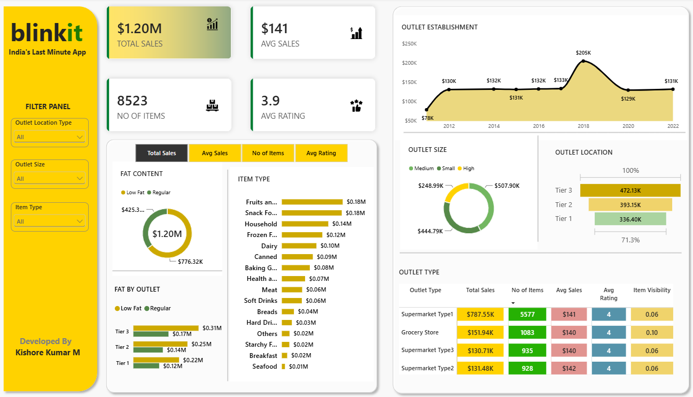

# Blinkit Retail Sales Analysis | Power BI

An interactive Power BI dashboard built to explore Blinkit retail sales performance across product categories, outlet characteristics, and customer ratings.

## Project Overview

This project analyzes retail sales data to understand product-level and outlet-level performance. The dataset was imported from Microsoft Excel, prepared using Power Query, and used to build an interactive Power BI report with KPI cards, visualizations, and slicers.

## Dashboard Preview

## Key Metrics

The dashboard highlights the following KPIs:

- **Total Sales:** Approximately $1.20M
- **Average Sales:** Approximately $141
- **Number of Items:** 8,523
- **Average Rating:** 3.9

*Metric values reflect the dashboard shown in this project and may vary if the underlying dataset is refreshed.*

## Analysis Areas

The dashboard provides insights into:

- **Fat Content:** Sales distribution by low-fat and regular product categories.
- **Item Type:** Contribution and performance across product categories.
- **Outlet Establishment:** Sales trends by outlet establishment year.
- **Outlet Size:** Comparison of sales across different outlet sizes.
- **Outlet Location Tier:** Sales performance across different location tiers.
- **Outlet Type:** Comparison of outlet formats using sales and related metrics.

## Tools & Technologies

- **Microsoft Excel** – Source dataset
- **Power Query** – Data cleaning and transformation, including column renaming and modifying column values.
- **Microsoft Power BI** – Dashboard development and data visualization.

## Project Workflow

1. Imported the retail sales dataset from Excel into Power BI.
2. Cleaned and transformed the data using Power Query.
3. Modified column values and prepared fields for analysis.
4. Created KPI cards to display key sales and customer-rating metrics.
5. Developed interactive charts to compare sales across product and outlet dimensions.
6. Added slicers and filters to enable dynamic exploration of dashboard insights.

## Key Features

- Interactive slicers and filters.
- KPI cards for important business metrics.
- Product category and outlet-level sales analysis.
- Visual comparison of sales performance.
- Interactive dashboard for exploring retail sales trends.

## Repository Contents

| File | Description |
|---|---|
| `BlinkIT Grocery Data.xlsx` | Source dataset |
| `Blinkit_Dashboard.pbix` | Interactive Power BI dashboard |
| `Dashboard_Screenshot.png` | Dashboard preview |
| `README.md` | Project documentation |

## How to View the Dashboard

1. Download the `Blinkit_Dashboard.pbix` file from this repository.
2. Open it using Microsoft Power BI Desktop.
3. If prompted, update the data source path to `BlinkIT Grocery Data.xlsx`.
4. Refresh the dataset if required.
5. Explore the dashboard using the available slicers and filters.

## Key Takeaway

This dashboard brings key retail sales indicators and product-level and outlet-level comparisons into one interactive report, making it easier to explore business performance patterns and identify areas for further analysis.

---

**Author:** Kishore Kumar M

